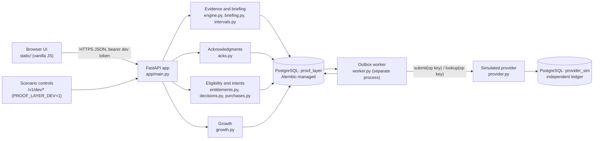
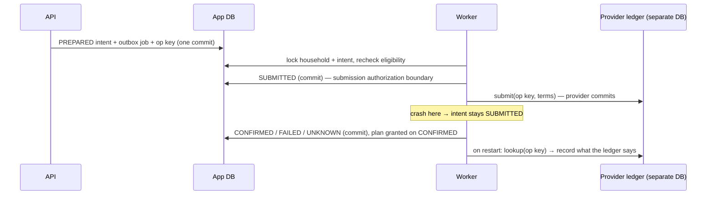

# Architecture

What is built today, not a future system. Independent engineering prototype; synthetic child records; simulated payments; not affiliated with Nanit.

## Shape

One application, one worker process, two databases. No broker, cache, or extra frontend framework: nothing here needs one at prototype scale.

## Modules

| Module | Owns | Key invariant |
|---|---|---|
| `security.py` | Dev tokens, principal resolution, authorization policy, household-scoped loading, household lock | Roles and households come from the database, never the client; foreign ids are 404 |
| `intervals.py` | Interval union, clip, subtract, intersect, minutes (UTC-normalized) | No double counting; real elapsed time across DST |
| `briefing.py` | Pure facts from evidence; semantic fingerprints | Coverage counts only usable camera observation; unknown stays unknown |
| `engine.py` | Windows, ingestion, corrections, revisions | Evidence append-only; one new revision per touched window; replay-safe |
| `acks.py` | Revision-bound acknowledgments, per-fact status | Acknowledgment covers only the displayed revision and facts; monotonic |
| `entitlements.py` | Versioned public-rule policy and simulated catalog | An offer exists only if it provably unlocks the feature |
| `claims.py` | Channel claims per camera; derived plan; one-camera codes | A camera's plan depends only on the set of its claims |
| `decisions.py` | Immutable per-camera capability snapshots, staleness, safety surfaces | Stale on state revision, catalog, policy, or expiry |
| `purchases.py` | Intent preparation, submission authorization, outcome recording | One intent per key; nothing outcome-like without provider evidence |
| `provider.py` | Simulated external provider with its own ledger | Idempotent per operation key; separate database and transaction |
| `worker.py` | Outbox claim/lease, submit, notify, reconcile | Duplicate delivery never creates a second operation |
| `growth.py` | Sticky assignment, render receipts, typed analytics, sample-ratio check | Exposure only from a render; no outcome read on a failed ratio check |
| `metrics.py` | Prometheus metrics | Aggregates only, by route template |
| `bench/` | Seeded data generator, load driver, experiment health | Writes only to the benchmark databases |

## The write path

Every write endpoint follows one order (`main.write_scope`):

1. Authenticate the bearer token, then resolve the member from the database.
2. `SELECT … FOR UPDATE` on the household row. This is the serialization point.
3. Re-read the membership under the lock, so a revocation that committed while the request waited still stops it.
4. Authorize the action for the member's role (billing additionally needs `can_bill`).
5. Load every resource with `household_id = caller's household`. Foreign ids get 404.
6. Apply the domain rule.
7. Commit once. Notification and submission work commit in the same transaction as the change that causes them (outbox).

Lock order is always household, then window or intent rows. Different households never contend. The cost is that writes within one household are serialized; at family scale that is the right trade, and finer locks wait for measured contention (build spec §9).

## The provider boundary

- The op key `op_<intent id>` is fixed at preparation and reused on every retry.
- After SUBMITTED commits, a household change cannot recall the call; the truthful outcome is still recorded (`test_changes_after_the_authorization_boundary_cannot_recall_the_submission`).
- The crash is real in the demo and in one test: the worker process calls `os._exit(17)` between the two commits.

## Data model (abridged)

`households` · `members` · `children` · `devices` (label, primary) · `entitlement_claims` (append-only; replaced `subscriptions` in migration 0003) · `commercial_config` · `evidence_events` (append-only) · `briefing_windows` · `briefing_revisions` (append-only) · `acknowledgments` (append-only) · `ack_heads` · `notifications` · `capability_decisions` · `purchase_intents` · `intent_transitions` (append-only) · `outbox` · `experiment_assignments` · `render_receipts` · `analytics_events` · `authorization_log`. Provider DB: `provider_operations`, `provider_scheduled_behaviors`.

Household-owned references are composite foreign keys `(household_id, x_id)`. See `proof-layer/app/models.py` and `migrations/versions/0001_initial_schema.py`. [DOMAIN.md](DOMAIN.md) lists the invariants and which layer enforces each.

## Frontend

`static/index.html`, `app.css`, `app.js`, `tokens.css` (copied from `design/tokens.css`). No build step. Screens keep the revision they displayed; polling only updates badges and the "newer version exists" banner. The X-Ray drawer reads `/v1/xray`, `/revisions` and `/evidence`. Scenario controls are dashed developer tooling, kept out of parent content.

## Not built (by design)

Real authentication, real payments, push notifications, native apps, multi-region, a message broker, a cache, and any real Nanit integration. See [LIMITATIONS.md](LIMITATIONS.md).

## Since the research gate

- **Plans per camera, from claims.** Migration 0003 replaced the household `subscriptions` row with append-only `entitlement_claims`. A confirmed simulated purchase is one more claim (`purchases.record_outcome` → `claims.record`).
- **One connection per request.** Audit and server analytics records ride on the request's connection (`db.keep()`), after a measured pool-starvation failure (`docs/BENCHMARKS.md`).
- **Present Mode** (`static/app.js`, `?present=recruiter|product|engineering`) drives the real actions; each step waits for the backend state its caption describes.
- **Week view** is computed on read from current revisions; nothing multi-night is stored.
